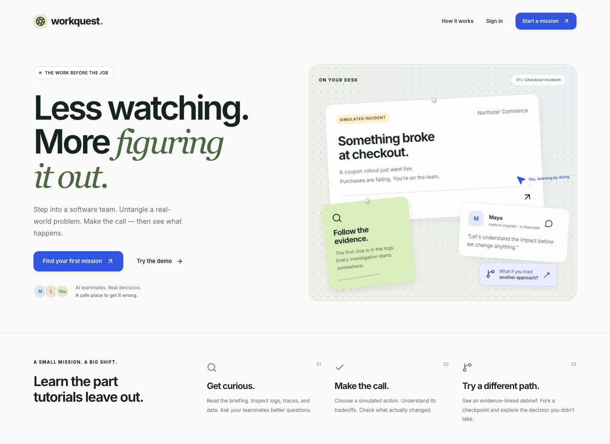

# WorkQuest

A workplace practice app: investigate an incident, talk with a simulated team, make decisions, and compare the consequences. Three complete missions cover a checkout outage, inventory overselling, and an analytics timezone error. A white glass interface, bold Inter typography, sage/cobalt accents, and a pegboard mission board give it a calm, tactile feel.

React + TypeScript + Vite · FastAPI + SQLAlchemy · PostgreSQL 18 · Redis + Celery. The deterministic engine owns state, logical time, verification and scores. AI provides bounded conversation and optional coaching; it cannot execute actions or assign points.



## Run locally

Prerequisites: Docker Desktop/Engine with Compose, Node **24.22.1**, pnpm **11.25.0**, Python **3.14.10**, and uv **0.13.6**. uv can install the pinned Python automatically. Start Docker first.

```sh
git clone https://github.com/Gagandeepkaurrr/WorkQuest.git
cd WorkQuest
make setup
make dev
```

For this existing checkout, use `cd /Users/gaggu/WorkQuest` and run the last two commands. `make setup` preserves an existing `.env`, generates random local secrets when absent, installs locked dependencies, starts PostgreSQL/Redis/Mailpit, migrates, seeds the three missions, and prepares Chromium. `make dev` runs the API, React app, worker and dispatcher; Ctrl-C stops those four processes.

- App: **http://localhost:5173**
- Local email inbox: **http://localhost:8025** — sign up in the app and follow the verification email here.
- API documentation: **http://localhost:8000/docs** (local only).
- `Try the demo` creates an isolated two-hour mock account. No default learner or administrator credentials exist.

```sh
make admin       # prompts privately for email, display name and password
make verify      # backend lint/types/tests, scenario checks, contract drift, frontend lint/tests/build
make e2e         # desktop + mobile browser journeys; keep make dev running
make audit       # package audits and redacted source credential scan
make backup-restore
make load        # isolated 20-learner, five-minute mock exercise
```

Admin creation is explicit. Promoting an existing account requires its current password. Sign in afterward and use Administration. No HTTP role-promotion endpoint exists.

A production-style local container preview is available with `make containers` at **http://localhost:8080**. Stop `make dev` before using that mode: the workers must share one consistent origin configuration. Stop containers with `make stop`; this preserves database volumes. Do not run `docker compose down -v` unless you intend to delete local data.

## Configure live AI

Default local/test mode is `AI_PROVIDER=mock`. To opt into Gemini, edit the private, gitignored `.env` with `AI_PROVIDER=gemini`, a supported `AI_MODEL`, and `GEMINI_API_KEY`. Restart all application processes. Never place keys in frontend code or commit them. After intentionally authorizing a potentially billable probe:

```sh
cd apps/api
uv run python -m app.cli.validate_provider --live
```

The probe validates one structured response and prints only model/usage metadata. Live credentials, real-provider behavior, external SMTP, and a public deployment need separate verification. Demo and administrator previews always use the mock provider.

## Deploy with Render and Vercel

Follow [the deployment commands and setup guide](docs/DEPLOY_RENDER_VERCEL.md). `render.yaml` provisions the backend services; `vercel.json` builds the SPA and proxies its API. Hosted integration, proxy identity, TLS and delivery checks remain unverified.

## Where things live

- `apps/web/src`: routes, accessible dialogs, evidence/actions/workspace, branch comparisons, debrief, admin and settings.
- `apps/api/app/engine`: pure mechanics, visibility, scoring and replay.
- `apps/api/content/scenarios`: backend-only authored definitions, golden and negative vectors.
- `apps/api/app/modules`: accounts, persistent runs, checkpoints, conversations, reports and administration.
- `apps/api/app/jobs`: PostgreSQL-backed durable work, quota reservations, fenced leases and recovery.
- `packages/contracts`: exported OpenAPI and scenario schema. `make contracts` regenerates frontend types.
- `infra`: non-root production images/proxy and vendor-neutral Compose reference.

Read [build status](docs/BUILD_STATUS.md), [release checks](docs/RELEASE_CHECKLIST.md), [requirements evidence](docs/REQUIREMENTS_MATRIX.md), [operations](docs/OPERATIONS.md), and [limitations](docs/KNOWN_LIMITATIONS.md) before a release. Local success is not evidence of a verified public deployment.
